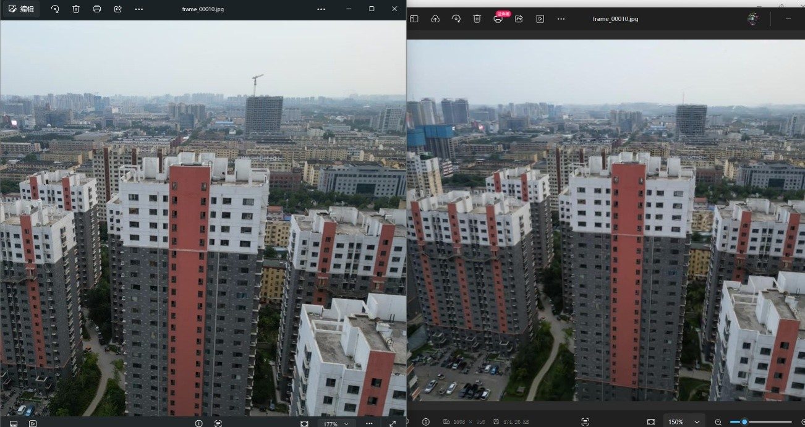
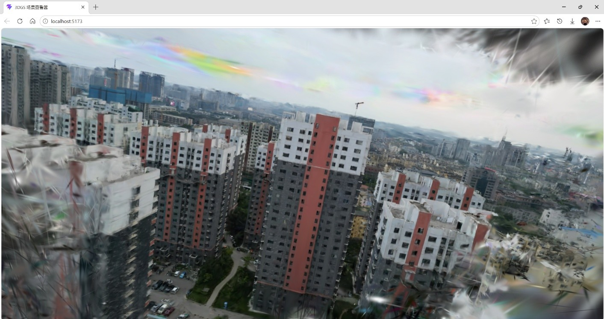
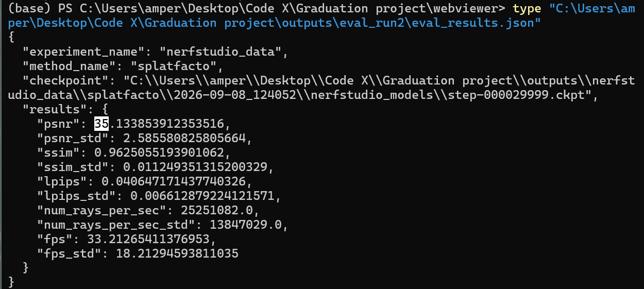

# 基于 3D Gaussian Splatting 的静态场景重建与 Web 可视化

本项目将一组普通相机、手机或无人机拍摄的重叠照片，加工为可在浏览器中交互查看的三维场景。完整链路为：

**影像 → COLMAP 相机位姿估计 → Nerfstudio Splatfacto（3DGS）训练 → 留出视角评测 → 导出 `.ply` → Three.js 网页查看**

项目面向**单管理员、单 GPU 工作站、串行任务**的本地场景重建，强调流程的可复现性与实验记录的可追踪性。

> 当前状态：一级端到端闭环已完成，二级系统开发进行中。详见文末「开发计划」。

---

## 一、项目简介

现有的开源工具（COLMAP、Nerfstudio 等）可以分别完成位姿估计、模型训练和结果浏览，但从原始照片到浏览器可访问场景之间，仍缺少一条能够记录数据质量、训练配置、评测指标与模型版本的统一流程。

本项目在成熟工具之上构建轻量流程，把上述环节串联起来，目标是让一次重建「用了什么配置、得到什么结果、结果能否在浏览器里查看」都有据可查。

**已实现的范围：**

- 影像 → COLMAP 稀疏重建与相机位姿估计
- Nerfstudio Splatfacto（3DGS）训练，支持快速档与高质量档两档迭代预算
- 留出视角质量评测：PSNR、SSIM、LPIPS
- 模型导出为浏览器可加载的 `.ply` 文件
- 自建 Web 三维查看器，支持旋转与缩放交互
- 实验记录：固定协议、产物路径、评测指标与口径说明

**尚未实现的范围：**

- 任务管理后端（FastAPI + SQLite）
- 标准档（15,000 迭代）与第二类静态场景实验
- 模型版本记录与发布控制

---

## 二、技术栈

| 环节 | 使用工具 |
|------|----------|
| 相机位姿估计与稀疏重建 | COLMAP |
| 3DGS 训练 | Nerfstudio 1.1.5（Splatfacto）、gsplat 1.4.0 |
| 深度学习运行时 | PyTorch 2.7.1+cu128、CUDA 12.8 |
| 模型导出 | `ns-export gaussian-splat`（导出为 `.ply`） |
| Web 三维查看 | Three.js、@mkkellogg/gaussian-splats-3d 0.4.7、Vite |

---

## 三、系统架构

系统按「训练层、服务层、分发层」三层划分：

```
训练层（本地工作站）
  影像预检 → COLMAP 位姿估计 → Splatfacto 训练 → 留出视角评测
        ↓ 生成 checkpoint
分发层（浏览器）
  ns-export 导出 .ply → Web 查看器加载 → 旋转 / 缩放查看
        ↑
服务层（规划中）
  任务管理与数据记录：项目 / 数据集 / 任务 / 模型 / 发布
```

- **训练层**：在本机 GPU 工作站完成影像预检、相机位姿估计与 3DGS 训练。
- **服务层**：负责任务管理与数据记录，保存项目信息、运行日志、评测指标与模型版本（本期尚未实现）。
- **分发层**：将确认后的模型文件导出，供浏览器只读查看。

---

## 四、仓库结构

```
.
├── README.md                 项目说明（本文档）
├── LICENSE                   开源许可证（MIT）
├── .gitignore                版本忽略规则
├── docs/                     文档
│   ├── project-report.md     阶段性报告
│   ├── design.md             系统设计
│   ├── experiments.md        实验记录与评测口径
│   └── images/               截图与对比图
├── scripts/                  可复现的流程脚本
│   ├── run_colmap.ps1        COLMAP 特征提取、匹配与稀疏重建
│   ├── run_train_cu128.bat   正式训练（30,000 迭代）
│   ├── run_train_smoke.bat   烟雾测试（5,000 迭代）
│   ├── run_eval_run1.bat     快速档评测
│   ├── run_eval_run2.bat     高质量档评测
│   ├── run_export_cu128.bat  导出 .ply 模型
│   ├── run_render_cu128.bat  渲染数据集视角
│   └── rebuild_gsplat_cu128.bat  gsplat CUDA 扩展编译
└── web/                      Web 三维查看器
    ├── index.html
    ├── package.json
    ├── vite.config.js
    └── src/main.js
```

> **不包含在本仓库**：原始影像数据集、COLMAP 数据库、训练 checkpoint、导出的 `.ply` 模型。这些文件体积较大，且原始影像含有拍摄元数据，请按「快速开始」自行生成。

---

## 五、快速开始

### 环境要求

- Windows 操作系统，NVIDIA 独立显卡（本项目验证于 RTX 4060 Laptop，8GB 显存）
- CUDA 12.8 与对应版本的 PyTorch（2.7.1+cu128）
- Conda 环境（Python 3.10），安装 `nerfstudio==1.1.5` 与 `gsplat==1.4.0`

### 步骤一：准备影像与位姿

```powershell
# 使用 COLMAP 完成特征提取、匹配与稀疏重建
.\scripts\run_colmap.ps1

# 将 COLMAP 结果转换为 Nerfstudio 数据格式
ns-process-data images --data <影像目录> --colmap-model-path <colmap sparse/0> --skip-colmap
```

### 步骤二：训练模型

```powershell
# 正式训练（30,000 迭代）
.\scripts\run_train_cu128.bat

# 或先跑烟雾测试（5,000 迭代）
.\scripts\run_train_smoke.bat
```

### 步骤三：评测与导出

```powershell
# 在留出视角上计算 PSNR / SSIM / LPIPS
.\scripts\run_eval_run2.bat

# 导出浏览器可加载的 .ply 模型
.\scripts\run_export_cu128.bat
```

### 步骤四：浏览器查看

```powershell
cd web
npm install
# 将导出的 splat.ply 复制到 web/public/ 目录
npm run dev
# 在浏览器中打开 http://localhost:5173
```

### Windows 环境注意事项

本项目在 Windows 环境下复现时遇到过若干环境问题，记录下来供参考：

1. **CUDA 版本需与 PyTorch 匹配**：gsplat 1.4.0 依赖 CUDA 12 及以上版本的 CUB 库，CUDA 11.8 会在编译阶段失败。
2. **MSVC 编译器版本**：CUDA 12.8 需要配合 MSVC 14.33（cl 19.33）；版本过新的 cl 19.44 不被接受。
3. **编译架构**：建议设置 `TORCH_CUDA_ARCH_LIST=8.9`（按实际显卡架构调整），避免为全部架构编译导致耗时过长。
4. **控制台编码**：设置 `PYTHONUTF8=1`，否则在中文 Windows 环境下可能出现 GBK 编码报错。
5. **浏览器跨源隔离**：三维查看器使用 SharedArrayBuffer，Vite 需配置 `Cross-Origin-Opener-Policy` 与 `Cross-Origin-Embedder-Policy` 响应头。

---

## 六、实验结果

在同一数据集、同一留出视角划分下，比较两档训练迭代预算的重建质量：

| 档位 | 迭代数 | PSNR（dB，越高越好） | SSIM（越高越好） | LPIPS（越低越好） |
|------|--------|----------------------|------------------|-------------------|
| 快速档 | 5,000 | 27.37 | 0.873 | 0.113 |
| 高质量档 | 30,000 | **35.13** | **0.963** | **0.041** |

**评测口径说明：**

以上指标基于**单一航拍场景与 5 张留出视角**，且无人机相邻帧高度重叠，测试视角与训练视角可能高度相似。该结果仅用于本场景的实验记录与链路验证，**不代表对任意场景的普遍性能结论**。后续需要通过更独立的场景与视角、以及多档对照实验，才能支撑普遍性结论。

---

## 七、效果展示







> 三张截图依次对应：Web 查看器交互查看、重建图与实拍原图对比、评测指标输出。

---

## 八、开发计划

- [x] COLMAP 位姿估计与数据转换
- [x] Splatfacto 训练（快速档 / 高质量档）
- [x] 留出视角评测（PSNR / SSIM / LPIPS）
- [x] 模型导出为 `.ply`
- [x] Web 三维查看器
- [x] 实验记录与评测口径说明
- [ ] 任务管理后端（FastAPI + SQLite）
- [ ] 标准档（15,000 迭代）与第二类静态场景实验
- [ ] 训练耗时、峰值显存、浏览器加载时间记录
- [ ] 模型版本记录与发布控制

---

## 九、数据与模型说明

原始影像、COLMAP 结果、训练 checkpoint 与 `.ply` 模型均不提交至本仓库，原因如下：

1. 体积较大（checkpoint 与模型文件合计数百 MB）；
2. 原始影像含有拍摄位置等元数据；
3. 均可通过「快速开始」中的脚本重新生成。

如需复现实验，请使用自己的影像数据，并参照 `docs/experiments.md` 中的实验协议与 `docs/design.md` 中的系统设计。

---

## 十、许可证

本项目采用 [MIT 许可证](LICENSE)。

---

## 十一、致谢

本项目的三维重建与训练基于以下开源工作，在此致谢：

- [COLMAP](https://colmap.github.io/)：运动恢复结构与多视图立体重建
- [Nerfstudio](https://docs.nerf.studio/)：神经辐射场与 3DGS 的模块化训练框架
- [gsplat](https://github.com/nerfstudio-project/gsplat)：高效的 3D 高斯光栅化实现
- [gaussian-splats-3d](https://github.com/mkkellogg/GaussianSplats3D)：浏览器端 3DGS 渲染
- [Three.js](https://threejs.org/)：Web 三维渲染库

以及 3D Gaussian Splatting 原始论文作者 Kerbl 等（SIGGRAPH 2023）。
